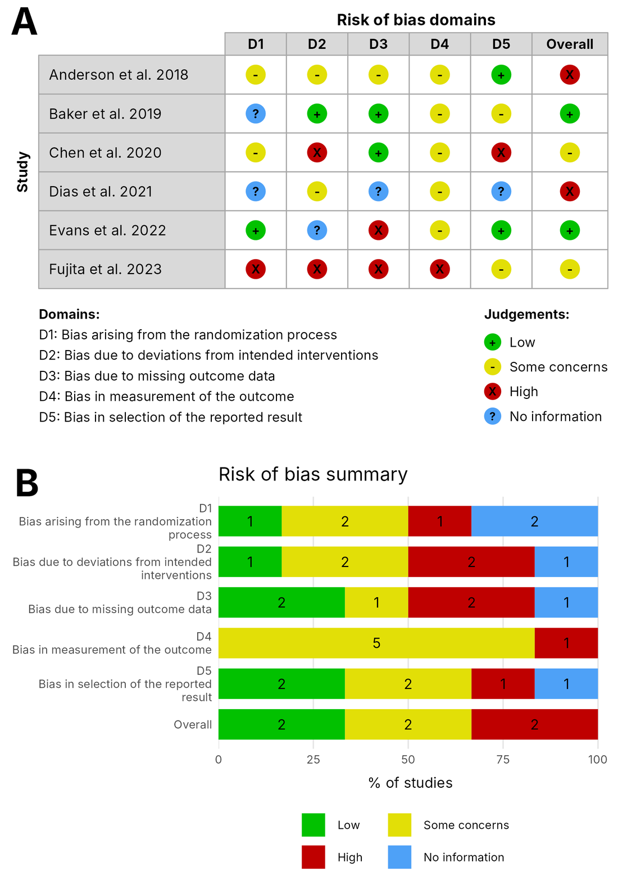

# AnyRoB

**Highly customizable traffic light and summary plots for any risk of bias tool.**

AnyRoB is a free, point-and-click R Shiny web app for making risk of bias figures for systematic reviews and meta-analyses. Unlike tools built around one assessment tool, AnyRoB lets you define everything yourself: domains and subdomains, judgement names, colours and symbols, and every label on the figure. It works with any domain-based tool, whether a published one such as RoB 2, ROBINS-I or QUADAS-2, or your own. No coding is needed.

### ▶ Open the app: **https://jonathanyuen.shinyapps.io/AnyRoB/**



---

## Features

- **Any risk of bias tool.** Ready-made templates for RoB 2, ROBINS-I, ROBINS-E, QUADAS-2 and RoBDEMAT, or start from a blank template and build your own.
- **Domains and subdomains.** Group subdomains under shared domain headings (for example D1 → 1.1, 1.2, 1.3), with an optional overall judgement column.
- **Your own judgements.** Name as many judgements as you need, and choose each one's colour, symbol, symbol colour and marker shape (circle, square or diamond). You can also choose whether it appears in the legend.
- **Live preview.** See the finished traffic light plot while you set up your tool.
- **Spreadsheet data entry.** Enter judgements from drop-down lists, paste from Excel, or fill in an Excel file and upload it.
- **Save and resume.** Save your whole project to one Excel file and reopen it later.
- **Publication-ready export.** Traffic light plot, summary plot, or a combined two-panel figure, as PNG, TIFF (uncompressed or LZW), JPEG or vector PDF at 300, 600 or 1200 dpi, at the on-screen size or a custom size.
- **Private.** Nothing is stored on the server; your data stays in your browser session and in files you save.

## How to use

### 1. Start
On the home page, choose one of:
- **Start building with a blank template** to design your own tool;
- **Choose a template to edit**, then **Start**, or **Start with example studies** to see finished figures straight away;
- **Continue a saved project**, which opens an Excel file saved earlier with *Save progress*.

### 2. Set up
- **Domains:** add domains and their full names. Tick **Use subdomains** to nest subdomains under each domain, and tick **Add an overall judgement column** if your tool has one. Labels (e.g. D1, 1.1) appear on the plot; full names appear in the key below it.
- **Judgements:** add each judgement and set its colour, symbol and symbol colour, either by clicking the colour box or typing a hex code. Use the arrows to set the legend order. Untick **Legend** to hide a judgement from the legend.
- The **Live preview** on the right updates as you go. Click the **?** icons for an illustrated guide.

### 3. Assessments
- Type one study per row and pick a judgement for each cell from the drop-down. You can also paste blocks of cells from Excel.
- **Fill empty cells** sets every blank cell to one judgement at once.
- **Prefer Excel?** Click **Save progress**, fill in the *Assessments* sheet of the downloaded file, and upload it here.
- Cells shaded red hold values that aren't in your judgement list, and are listed below the table so you can fix them.

### 4. Plots and export
- Switch between the **Traffic light plot (A)**, **Summary plot (B)** and **Combined figure (A + B)** tabs.
- Open the **Customise** panel to edit titles, panel letters, footnotes, legend text, fonts, sizes and colours. **Reset to default** undoes your changes.
- Under **Export**, choose the file format and resolution, optionally set custom dimensions, and download.

### Save your progress
Click **Save progress** (top right, on any page) to download an Excel file. It contains your domains, judgements, assessments and plot settings. Open it from the home page to carry on later. The app does not keep your work after you close the page, so save often.

## Run AnyRoB on your own computer

1. Install [R](https://cran.r-project.org/) (and optionally RStudio).
2. Install the required packages once:
   ```r
   install.packages(c("shiny", "bslib", "rhandsontable", "colourpicker",
                      "ggplot2", "gtable", "openxlsx", "ragg"))
   ```
3. Download this repository, then run:
   ```r
   shiny::runApp("path/to/AnyRoB")
   ```

## Citation

If AnyRoB was useful for your research, please cite it:

> Yuen, J. J. X. (2026). *AnyRoB: A highly customizable R Shiny web application for generating risk-of-bias traffic-light and summary plots for any assessment tool* (Version 1.0.0) [Computer software]. Zenodo. https://doi.org/10.5281/zenodo.XXXXXXX

<!-- TODO: replace the DOI after the first Zenodo release -->

You can also use **Cite this repository** on this GitHub page, or download the citation as .ris, .nbib or .bib from the app's home page.

Please also cite the risk of bias tool you used for your assessments.

## Licence

Released under the [MIT Licence](LICENSE).

## Contact

Questions, bug reports and suggestions are welcome: please [open an issue](../../issues) on this repository.
